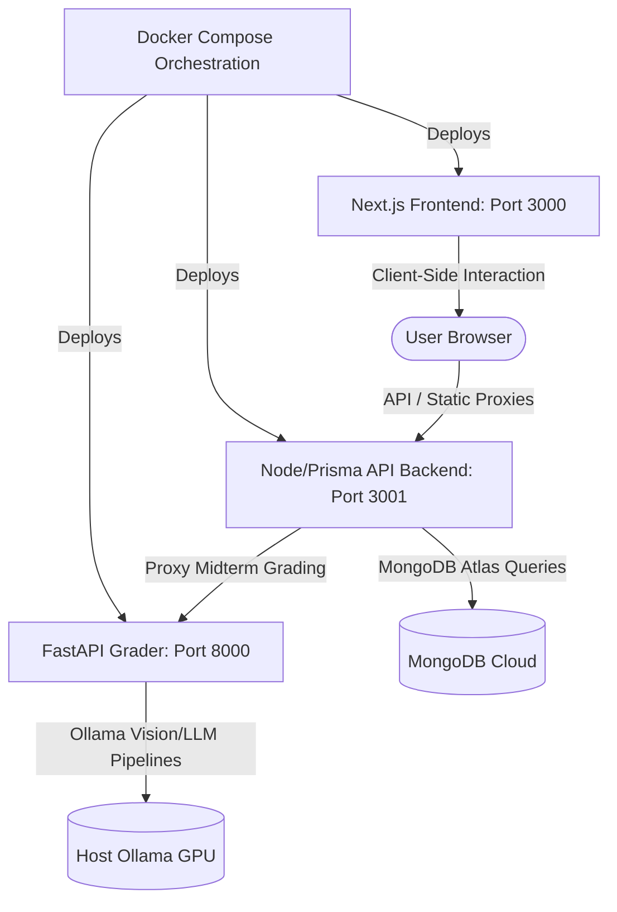

# Cadence: A Conflict-Aware Timetable Management & LLM-Powered Answerbook Assessment System

<div align="center">


**Cadence** is an enterprise-grade academic resource scheduling and automated examination grading platform. It integrates a **Conflict-Aware Timetable Management Engine** for conflict-free planning with an **LLM-Powered Answerbook Assessment System** that uses local vision models to digitize, index, and grade handwritten student exams.


</div>

---

## 🏛️ System Architecture

Cadence is designed as a modular, three-tier microservices architecture orchestrating diverse technologies into a unified experience:



*   **Frontend (`timetable-light`)**: Built on Next.js 16 (App Router) and TailwindCSS. Offers interfaces for administrators (room, lab, class layouts), teachers (weekly grids and grading portal), and students (timetables and midterm scores).
*   **Backend API (`time-table-backend`)**: Powered by Express.js and TypeScript, utilizing Prisma ORM linked to MongoDB Atlas for conflict-detection databases.
*   **AI Microservice (`gradeai`)**: Built on Python 3.10 and FastAPI. Integrates sentence-transformers and local Ollama pipelines (using vision-OCR and text generation) to digitize and mark handwritten papers.

---

## ⚡ Unified Container Setup (Docker Compose)

The fastest and most robust way to spin up the entire container network is using **Docker Compose**. It configures networking, host GPU mappings, and volume mounts out of the box.

### Prerequisites
1.  **Docker Desktop** installed on your host machine.
2.  **Ollama** running locally on your host machine (with high-speed GPU acceleration). Make sure to pull the required LLMs:
    ```bash
    ollama pull minicpm-v:latest  # Vision-OCR Model
    ollama pull mistral:latest    # Reasoning/Grading Model
    ```

### Running the System
From the root workspace folder, run the unified build and start sequence:
```bash
docker compose up --build
```

This will automatically bootstrap:
*   **Cadence Frontend** running on [http://localhost:3000](http://localhost:3000)
*   **Cadence API Backend** running on [http://localhost:3001](http://localhost:3001)
*   **GradeAI Microservice** running on [http://localhost:8000](http://localhost:8000)

---

## 🛠️ Manual Local Development

If you prefer to run each service manually on your host system:

### 1. Database & Backend API Setup
Navigate to the backend folder:
```bash
cd time-table-backend
npm install
```
Set up your `.env` variables (e.g. `DATABASE_URL` for MongoDB Atlas). Run database schema generators and start the server:
```bash
npx prisma db push
npm run dev
```

### 2. Next.js Frontend Setup
Navigate to the frontend folder:
```bash
cd timetable-light
npm install
npm run dev
```
Open [http://localhost:3000](http://localhost:3000) in your browser.

### 3. AI Microservice Setup
Navigate to the Python grading folder:
```bash
cd gradeai
python -m venv .venv
# On Windows
.venv\Scripts\activate
# On Linux/macOS
source .venv/bin/activate

pip install -r requirements.txt
uvicorn api:app --reload --port 8000
```

---

## 🔒 Default Admin Credentials
*   **Email**: `admin@dept.local`
*   **Password**: `changeme`
